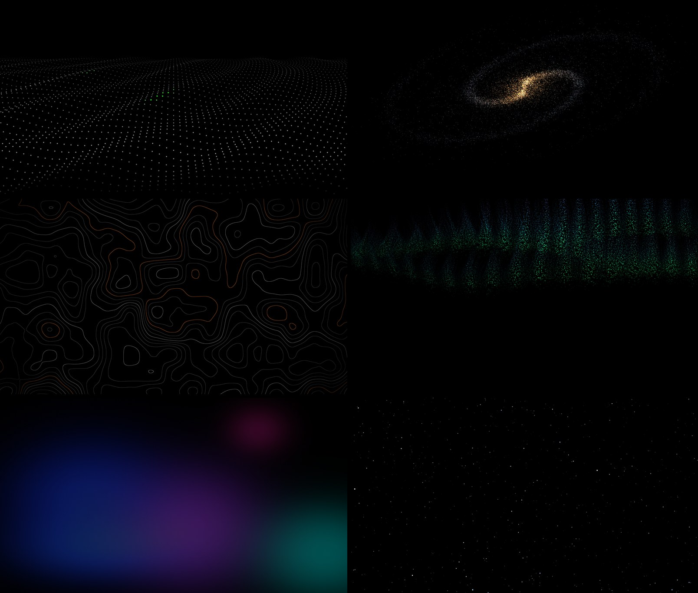

# nxpaper

Animated wallpapers for macOS, made for OLED screens: pure black backgrounds, and every lit pixel keeps moving.



Click the waves icon in the menu bar to open a panel of live previews. Click one to put it on every screen.

- Sits under the desktop icons on every display, follows display changes.
- Pauses when the screens sleep, the Mac is locked, or windows cover the desktop.
- Pause button and launch at login in the panel.
- Rendered with WebGL at 30 fps, around 10% of one core.

## Build

Needs macOS 14+ and the Xcode command line tools.

```sh
./build.sh
```

Builds `nxpaper.app`, installs it to `~/Applications` and launches it.

## Add a wallpaper

Drop an HTML file into `Resources/wallpapers/` and rebuild. Its `<title>` is the name in the panel. Follow `fala.html`:

- `window.setPaused(bool)` stops and resumes the animation.
- `?t=<seconds>` freezes time, for stills.
- Sizes scale with the screen height, so it reads the same in a small preview tile.

## License

MIT. Bricolage Grotesque is under the SIL Open Font License (`Resources/Fonts/OFL.txt`).
