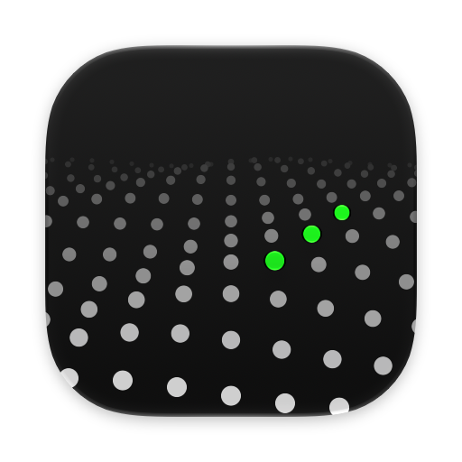

<div align="center">



# nxpaper

**Animated wallpapers for macOS, made for OLED screens.**

Pure black backgrounds, and every lit pixel keeps moving.

[](https://github.com/noyex/nxpaper/releases/latest)

[](LICENSE)

[**Download for Mac**](https://github.com/noyex/nxpaper/releases/latest/download/nxpaper.dmg)


</div>

## Features

- Click the waves icon in the menu bar to open a panel of live previews. Click one to put it on every screen.
- Sits under the desktop icons on every display, follows display changes.
- Pauses when the screens sleep, the Mac is locked, or windows cover the desktop.
- Pause button and launch at login in the panel.
- Rendered with WebGL at 30 fps, around 10% of one core.
- No network requests: the wallpapers are local HTML files inside the app.

Runs on Apple silicon and Intel.

## Install

You need macOS 14 or later.

### Option 1: one command (recommended)

```sh
curl -fsSL https://raw.githubusercontent.com/noyex/nxpaper/main/install.sh | bash
```

Downloads the latest release into `/Applications`, replaces an older copy and starts nxpaper.
Run it again to update.

### Option 2: DMG

1. Download [**nxpaper.dmg**](https://github.com/noyex/nxpaper/releases/latest/download/nxpaper.dmg), open it and drag nxpaper into Applications.
2. Open nxpaper. nxpaper isn't notarized by Apple, so the first time macOS says it can't verify the app.
   Click **Done**, then go to **System Settings → Privacy & Security** and click **Open Anyway** next to nxpaper.
   On macOS 14, right-click nxpaper in Applications and choose **Open** instead.

<details>
<summary>Prefer the terminal for step 2?</summary>

```sh
xattr -d com.apple.quarantine /Applications/nxpaper.app && open /Applications/nxpaper.app
```

</details>

### Option 3: build from source

Needs the Xcode command line tools.

```sh
git clone https://github.com/noyex/nxpaper.git
cd nxpaper
scripts/build-app.sh --install   # builds nxpaper.app, copies it to /Applications and launches it
```

## Add a wallpaper

Drop an HTML file into `Resources/wallpapers/` and rebuild. Its `<title>` is the name in the panel. Follow `fala.html`:

- Pure black background, and every lit pixel keeps moving.
- `window.setPaused(bool)` stops and resumes the animation.
- `?t=<seconds>` freezes time, for stills.
- Sizes scale with the screen height, so it reads the same in a small preview tile.
- Self-contained: no network, no external scripts or fonts.

The full contract is in [AGENTS.md](AGENTS.md).

## Uninstall

Turn off launch at login in the panel, quit nxpaper from the panel, then:

```sh
rm -rf /Applications/nxpaper.app
defaults delete com.noyex.nxpaper   # the saved wallpaper and pause choice
```

## Development

```sh
scripts/build-app.sh             # build/nxpaper.app, arm64
scripts/build-app.sh --universal # arm64 + x86_64, what releases use
scripts/build-app.sh --install   # copy to /Applications and launch
```

Releasing: **Actions → Release → Run workflow** with a version like `v1.2.3` (or
`gh workflow run release.yml -f version=v1.2.3`). It tags `main`, builds a universal `nxpaper.dmg` and
`nxpaper.zip` (`scripts/package.sh`) and publishes them as a GitHub release. `scripts/release.sh v1.2.3`
does the same locally.

Bug reports, wallpaper ideas and pull requests are welcome: [open an issue](https://github.com/noyex/nxpaper/issues/new/choose) or read [CONTRIBUTING.md](CONTRIBUTING.md) for how to send a PR.

## License

MIT. Set in [Bricolage Grotesque](https://github.com/ateliertriay/bricolage) (SIL Open Font License, see `Resources/Fonts/OFL.txt`).
